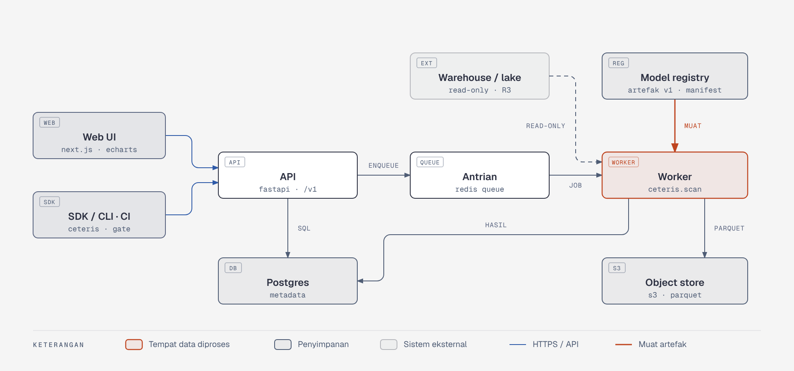
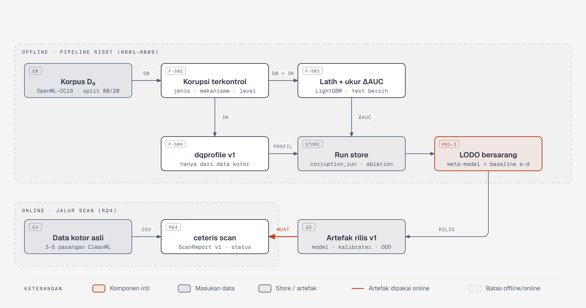
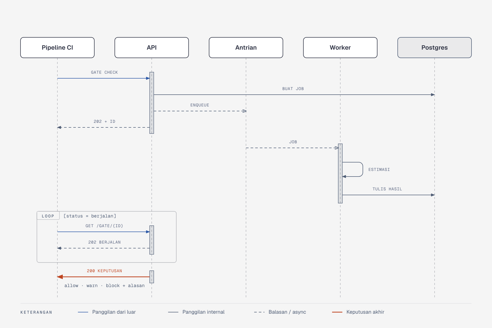

# Arsitektur Ceteris

Dokumen ini menjelaskan **bagaimana** Ceteris disusun: komponen, alur data, tanggung jawab tiap lapisan, batasan yang tidak boleh dilanggar, kebutuhan non-fungsional, dan integrasi. Alasan produknya ada di [product.md](product.md); aturan angka dan keputusan ada di [business-rules.md](business-rules.md); istilah ada di [domain/glossary.md](domain/glossary.md).

Penanda: **[F]** fakta terverifikasi · **[K]** keputusan desain · **[T]** terbuka. Tanpa penanda berarti **[K]**.

## 1. Status dan prinsip

**[F] Status per 10/11/2026:** belum ada kode. Dokumen ini menggambarkan arsitektur sasaran. Bagian yang berlaku untuk R0 (satu paket Python, tanpa server) ditandai **R0**; sisanya baru dibangun mulai R1.

Empat prinsip menurunkan semua keputusan di bawah:

1. **Satu jalur kode untuk riset dan produk.** Profil yang dipakai melatih meta-model dihitung oleh kode yang sama dengan profil saat scan.
2. **Artefak berversi sebagai satu-satunya sambungan riset → produk.** Produk memuat artefak; produk tidak menjalankan kode eksperimen.
3. **Data diproses di lingkungan pengguna.** Perhitungan terjadi di worker; default deployment adalah lokal atau self-host.
4. **Satu kontrak keluaran.** `ScanReport` sama persis di CLI, Python API, dan REST API.

## 2. Konteks

| Aktor atau sistem | Interaksi | Mulai |
| --- | --- | --- |
| Peneliti | Menjalankan pipeline eksperimen dan merilis artefak model | R0 |
| ML engineer (P1) | `ceteris scan` dari notebook atau CI; membaca laporan | R0 |
| Sistem CI (GitHub Actions, GitLab CI) | Memanggil gate sebelum training atau deploy | R2 |
| Kanal notifikasi (Slack, email) | Menerima peringatan gate | R2 |
| Identity provider | Login pengguna (OIDC) | R2 |
| Data engineer (P2) | Mendaftarkan koneksi, mengatur promotion gate | R3 |
| Warehouse/lake (BigQuery, Snowflake, Postgres, S3/Parquet) | Sumber data yang dipindai, **read-only** | R3 |
| Tools kualitas data (Soda, Great Expectations) | Sumber temuan yang diimpor | R3 |
| Head of data (P3), konsumen data (P4) | Health score, trust signal API | R4 |

## 3. Kontainer



*Delapan kontainer sasaran (R1 ke atas). Worker adalah fokus: semua perhitungan profil dan estimasi terjadi di sana. Sumber: [diagrams/src/arsitektur-kontainer.html](diagrams/src/arsitektur-kontainer.html).*

| Kontainer | Teknologi | Tanggung jawab | Tidak boleh | Mulai |
| --- | --- | --- | --- | --- |
| SDK/CLI | Paket `ceteris` (Typer) | Scan lokal, atau memanggil API; hasil `ScanReport` sama di kedua mode | Menghasilkan struktur keluaran yang berbeda dari API | R0 |
| Worker | Python, paket `ceteris` | Membaca data, kontrak input, profil, estimasi, status, prioritas; menulis hasil | Menulis ke sumber data; melatih meta-model | R1 |
| API | FastAPI | Autentikasi, validasi permintaan, kebijakan, membuat job, menyajikan laporan dan keputusan gate | Menghitung profil atau estimasi | R1 |
| Antrian | Redis Queue | Job scan dan job terjadwal | Menyimpan data mentah | R1 |
| Metadata store | Postgres | Dataset, scan, temuan, estimasi, kebijakan, audit | Menyimpan data mentah yang dipindai | R1 |
| Object store | S3-compatible (MinIO untuk self-host) | Snapshot Parquet data yang dipindai, laporan HTML | — | R1 |
| Model registry | Bucket object store + manifest | Artefak meta-model, kalibrator, referensi OOD, laporan akurasi | Menerima artefak tanpa metadata wajib | R1 |
| Web UI | Next.js + ECharts | Laporan, dashboard, pengaturan kebijakan | Menghitung status sendiri | R1 |

Pada **R0** hanya ada SDK/CLI. Model registry digantikan folder rilis, metadata store dan object store digantikan run store Parquet + DuckDB.

## 4. Komponen paket `ceteris`

Paket `ceteris` adalah isi worker dan CLI. Draft memakai nama kerja `dqimpact`; nama paket dan perintah diganti menjadi `ceteris`, sedangkan nama skema profil `dqprofile` v1 dipertahankan.

| Modul | Fitur | Tanggung jawab | Dipakai jalur | Menjadi (R1+) |
| --- | --- | --- | --- | --- |
| `ceteris.corpus` | F-S01 | Unduh, saring, split, catat lisensi | Riset | Pipeline retrain meta-model |
| `ceteris.corrupt` | F-S02 | Fungsi korupsi deterministik | Riset | Pipeline retrain |
| `ceteris.train` | F-S03, F-S06 | Learner acuan, AUC, noise floor terukur | Riset | Pipeline retrain |
| `ceteris.dqprofile` | F-S04, F-S05, F-S06 | Praproses kontrak input, quality profile, label noise, noise floor estimasi | Riset **dan** scan | Dipakai worker tanpa perubahan |
| `ceteris.store` | F-S07 | Skema Parquet/DuckDB, run log, experiment registry | Riset | Store offline |
| `ceteris.metamodel` | F-S08, F-S09 | Melatih meta-model dan baseline; memuat artefak | Riset; scan (muat saja) | Model registry |
| `ceteris.uncertainty` | F-S10 | Interval conformal, skor OOD | Riset **dan** scan | Impact Engine |
| `ceteris.evaluate` | F-S11 | LODO bersarang, uji statistik | Riset | Uji regresi sebelum rilis artefak |
| `ceteris.recovery` | F-S12 | Potensi pemulihan per temuan | Riset **dan** scan | Prioritizer (F-L08) |
| `ceteris.scan` | F-S13, F-S14 | Orkestrasi scan, status, `ScanReport` (Pydantic), CLI | Scan | Worker scan + REST API |

Komponen yang ditambahkan di worker sesudah R0: **adapter** (membaca CSV, Parquet, atau tabel warehouse ke format standar; F-L10), **reporter** (laporan HTML; F-L02), dan **exact engine** (hitung ulang metrik dengan dan tanpa temuan; F-L12).

### 4.1 Tanggung jawab per lapisan

| Lapisan produk | Komponen | Menerima | Menghasilkan | Bergantung pada |
| --- | --- | --- | --- | --- |
| **Scan** | Adapter, `dqprofile` | Data kotor + nama kolom target | Profil v1, temuan, peringatan input | — |
| **Impact Engine** | `metamodel` (muat), `uncertainty`, status di `scan` | Profil v1 + artefak model | ΔAUC, ΔAUC relatif, interval 90%, skor OOD, status | Scan |
| **Control** | `recovery`, gate di API, simulator | Estimasi + temuan + kebijakan | Urutan temuan, keputusan allow/warn/block, hasil simulasi | Impact Engine |
| **Trust** | API + metadata store | Estimasi per tabel, hasil aktual dari pengguna | Trust signal, health score, akurasi lapangan | Impact Engine |
| **Translate** | Cost model | Estimasi + cost model pengguna | Dampak rupiah beserta asumsinya | Impact Engine |

Ketergantungan hanya satu arah: Scan → Impact Engine → lapisan konsumen. Lapisan konsumen tidak saling memanggil dan tidak menghitung ulang estimasi.

## 5. Alur data

### 5.1 Offline ke online



*Pipeline riset (offline) menghasilkan artefak berversi; jalur scan (online) memuatnya. Sumber: [diagrams/src/alur-data.html](diagrams/src/alur-data.html).*

**Offline (riset, R0).**

1. `corpus` mengunduh dataset OpenML-CC18, menyaringnya, dan membuat split tetap → dataset dasar D₀.
2. `corrupt` menyuntikkan korupsi ke partisi latih → dataset kotor Dₖ ([BR-80](business-rules.md#9-aturan-eksperimen)).
3. `train` melatih learner acuan pada D₀ dan Dₖ, lalu mengukur ΔAUC pada test set bersih ([BR-01](business-rules.md#1-ukuran-dasar)).
4. `dqprofile` menghitung profil **hanya dari Dₖ** ([BR-20](business-rules.md#3-estimasi-dan-interval)).
5. Pasangan (profil, ΔAUC) ditulis ke run store.
6. `evaluate` menjalankan LODO bersarang atas meta-model dan baseline.
7. Artefak v1 dirilis di G3: meta-model, kalibrator, referensi OOD, laporan akurasi.

**Online (scan).**

1. Data kotor pengguna melewati kontrak input; pelanggaran berat menghentikan scan tanpa estimasi parsial.
2. `dqprofile` menghitung profil dan noise floor estimasi.
3. Meta-model dimuat dari artefak dan memberi ΔAUC; `uncertainty` memberi interval dan skor OOD.
4. Status ditentukan menurut [BR-30 sampai BR-35](business-rules.md#4-status-hasil-scan).
5. `recovery` menghitung potensi pemulihan per temuan.
6. `ScanReport` ditulis.

**Umpan balik (R4).** Hasil aktual yang dilaporkan pengguna dan profil anonim (dengan izin) dikirim ke riset sebagai kandidat validasi eksternal. Umpan balik **tidak** mengubah korpus pelatihan yang sudah dibekukan; ia masuk lewat rilis artefak berikutnya.

### 5.2 Alur utama: gate CI



*Pipeline CI meminta keputusan gate untuk data latih baru. Scan berjalan asinkron; CI melakukan polling. Sumber: [diagrams/src/sequence-gate.html](diagrams/src/sequence-gate.html).*

1. CI memanggil `POST /v1/gate/check` dengan dataset dan kebijakan.
2. API membuat `gate_run` dan `scan` berstatus *queued*, memasukkan job ke antrian, lalu menjawab `202` dengan `gate_run_id`.
3. Worker menjalankan alur online di atas dan menulis temuan, estimasi, dan keputusan.
4. CI melakukan polling `GET /v1/gate/{gate_run_id}` sampai keputusan tersedia.
5. Keputusan mengikuti [BR-50 dan BR-51](business-rules.md#6-gate), disertai alasan dan tautan laporan.

## 6. Kontrak dan penyimpanan

### 6.1 `ScanReport` v1

Kontrak penghubung antara R0 dan produk. Struktur yang ditulis `ceteris scan` sama dengan respons `GET /v1/scans/{id}/report`.

```json
{
  "schema_version": "1.0",
  "scan_id": "scn_01H...",
  "model": {"version": "1.0.0", "experimental": false, "profile_schema_version": "v1"},
  "estimate": {"metric": "auc", "delta": 0.031, "delta_relative": 0.09,
               "interval_90": [0.012, 0.050], "ood_score": 0.42},
  "status": {"value": "material", "threshold": 0.010, "noise_floor_estimated": 0.004},
  "findings": [{"issue_type": "label_noise", "column": null, "rows_affected_pct": 7.1,
                "observed_or_estimated": "estimated", "recovery_potential": 0.022}],
  "input_warnings": ["id_column_dropped: customer_id"],
  "condition": "dibanding model yang dilatih pada versi bersih dan dievaluasi pada data bersih"
}
```

Angka di atas adalah ilustrasi. Nilai `status.value` yang sah: `material`, `tidak_material`, `tidak_yakin`.

### 6.2 Artefak riset → produk

| Artefak | Isi | Format | Siap di | Sebelum siap, produk memakai |
| --- | --- | --- | --- | --- |
| `dqprofile` v1 | Kode perhitungan profil | Modul Python | G1 | Dibangun bersama sejak awal |
| Spesifikasi learner acuan | Versi LightGBM, parameter, protokol split | YAML | G1 | Langsung dipakai |
| Meta-model pilot | Meta-model dari 5 dataset pilot | `.txt` LightGBM + metadata | G2 | Model dummy berbasis aturan |
| Meta-model v1 + kalibrator | Korpus penuh + skor kalibrasi conformal | `.txt` + `.parquet` | G3 | Meta-model pilot, berlabel eksperimental |
| Referensi OOD | Profil korpus pelatihan untuk jarak kNN | `.parquet` | G3 | Profil pilot |
| Laporan akurasi | MAE, coverage, Spearman per jenis korupsi; kondisi tidak andal | Tabel + ringkasan | G3, diperbarui G4 | Tidak ada; klaim akurasi tidak tampil |

Metadata wajib setiap artefak model: `profile_schema_version`, `learner_spec_version`, `corpus_snapshot`, tanggal latih, ringkasan coverage.

### 6.3 Penyimpanan

| Store | Isi | Teknologi | Mulai |
| --- | --- | --- | --- |
| Run store (offline) | `corpus_dataset`, `corruption_run`, `ablation_run`, `lodo_result`, `run_log` | Parquet + DuckDB | R0 |
| Metadata store (online) | `dataset`, `scan`, `finding`, `impact_estimate`, `model_version` (R1); `simulation`, `gate_policy`, `gate_run`, `audit_log` (R2); `source_connection` (R3); `feedback`, `trust_signal`, `data_contract` (R4); `cost_model` (R5) | Postgres | R1 |
| Object store | Snapshot data yang dipindai (dirujuk lewat `snapshot_uri`), laporan HTML | S3-compatible | R1 |

`impact_estimate.finding_id = null` berarti estimasi total scan. Estimasi dipertahankan untuk audit, sehingga scan dihapus lewat *soft delete* (`deleted_at`).

### 6.4 API

Semua endpoint di bawah `/v1`, memakai bearer token (pengguna) atau token layanan (CI), dan mengembalikan galat dalam bentuk `{"error": {"code", "message", "details"}}`.

| Endpoint | Fungsi | Fitur | Rilis |
| --- | --- | --- | --- |
| `POST /datasets` | Mendaftarkan dataset dan kolom target | F-L01 | R1 |
| `POST /scans` · `GET /scans/{id}` | Membuat scan (202) dan membaca statusnya | F-L01 | R1 |
| `GET /scans/{id}/report` | `ScanReport` v1 (`?format=json\|html`) | F-L01, F-L02 | R1 |
| `GET /datasets/{id}/scans` | Histori dan perbandingan terakhir | F-L03 | R1 |
| `POST /scans/{id}/simulate` | Simulasi what-if | F-L07 | R2 |
| `POST /gate/check` · `GET /gate/{gate_run_id}` | Meminta dan membaca keputusan gate | F-L06 | R2 |
| `POST /findings/import` · `POST /sources` | Impor temuan Soda/GX; mendaftarkan koneksi | F-L10 | R3 |
| `POST /scans/{id}/feedback` | Melaporkan hasil aktual | F-L14 | R4 |
| `GET /trust/{table_ref}` | Trust signal per tabel | F-L13 | R4 |

## 7. Architectural constraints

Batasan ini mengikat setiap perubahan kode. Melanggarnya memerlukan perubahan dokumen ini lebih dulu.

| ID | Batasan | Alasan | Verifikasi |
| --- | --- | --- | --- |
| AC-1 | Hanya ada satu implementasi profil, `ceteris.dqprofile`, dipakai riset dan scan. | Fitur saat melatih harus sama dengan fitur saat scan (BR-16) | Uji konsistensi jalur |
| AC-2 | `dqprofile` hanya menerima satu dataset (data kotor) dan nama kolom target. | Mencegah kebocoran versi bersih atau level korupsi (BR-20) | Uji isolasi profil |
| AC-3 | Jalur scan (`scan`, `dqprofile`, `uncertainty`, `recovery`, pemuat artefak) tidak mengimpor `corpus`, `corrupt`, atau `evaluate`. | Produk bergantung pada artefak, bukan kode eksperimen | Uji impor di CI |
| AC-4 | Jalur scan tidak melatih meta-model dan tidak menulis ke model registry. | Hasil scan harus bisa diaudit ke satu versi artefak (BR-21) | Registry hanya-baca bagi worker |
| AC-5 | `ScanReport` identik di CLI, Python API, dan REST API; worker membungkus fungsi yang sama. | Satu kontrak keluaran | Uji konsistensi jalur SDK vs API |
| AC-6 | Semua perhitungan atas data pengguna terjadi di worker. API, antrian, dan metadata store tidak menyimpan data mentah. | Batas privasi yang jelas (BR-71) | Tinjauan skema; uji integrasi |
| AC-7 | Akses ke sumber data bersifat read-only. | Source-faithful advisory (BR-70) | Kredensial read-only; tidak ada jalur tulis |
| AC-8 | Skor OOD dihitung dari profil tetapi bukan fitur meta-model. | OOD menilai estimasi, bukan bagian darinya (BR-24) | Daftar fitur meta-model |
| AC-9 | Versi profil dan versi artefak harus cocok; ketidakcocokan menghasilkan galat. | Mencegah estimasi dari skema yang salah (BR-23) | Uji unit |
| AC-10 | Kontrak (`ScanReport`, API) berversi; perubahan yang merusak hanya di versi mayor. | Laporan lama tetap terbaca (BR-60) | Contract test |
| AC-11 | Store offline (Parquet/DuckDB) dan store online (Postgres) terpisah; skema `corruption_run` tidak dipecah. | Data riset tetap bisa dipakai retrain | Tinjauan skema |
| AC-12 | Scan deterministik: sampel dan probe memakai seed tetap. | Dua scan pada data yang sama memberi hasil yang sama (BR-12) | Uji determinisme |

## 8. Kebutuhan non-fungsional

Target adalah usulan awal dan disesuaikan setelah uji beban R1.

| ID | Kategori | Kebutuhan | Target awal | Verifikasi |
| --- | --- | --- | --- | --- |
| NFR-1 | Performa | Waktu scan | Median ≤ 5 menit untuk 100.000 baris × 100 kolom | Uji beban di CI rilis |
| NFR-2 | Performa | Latensi API sinkron (bukan scan) | p95 ≤ 300 ms | Uji beban |
| NFR-3 | Skalabilitas | Scan paralel | Bertambah linear sampai 20 worker | Uji beban |
| NFR-4 | Ketersediaan | API dan gate | 99,5% per bulan (hosted); perilaku gate saat layanan mati bisa dikonfigurasi | Monitoring |
| NFR-5 | Keamanan | Data saat transit dan tersimpan | TLS 1.2+; enkripsi at-rest object store dan Postgres; kredensial di secret manager | Audit konfigurasi |
| NFR-6 | Keamanan | Rantai pasok | SAST, pemindaian dependensi dan lisensi di setiap PR | Gate CI |
| NFR-7 | Privasi | Data mentah | Default lokal/self-host; hosted: retensi ≤ 24 jam | Uji retensi otomatis |
| NFR-8 | Akurasi | Estimasi learned | Tidak lebih buruk dari laporan akurasi artefak sebelumnya | Uji regresi model |
| NFR-9 | Observabilitas | Jejak scan | Setiap scan punya trace dan log berkorelasi `scan_id` | Inspeksi |
| NFR-10 | Kompatibilitas | Kontrak | `ScanReport` dan API berversi | Contract test |
| NFR-11 | Maintainability | Kode | Cakupan uji unit ≥ 80% untuk paket inti `ceteris` | Laporan cakupan |

Untuk R0 berlaku tambahan **reprodusibilitas**: seed turunan ([BR-84](business-rules.md#9-aturan-eksperimen)), LightGBM deterministik, `uv.lock`, image digest dan commit dicatat di setiap baris `run_log`, notebook hanya dijalankan lewat papermill.

## 9. Integrasi

| Integrasi | Arah | Protokol | Batasan | Rilis |
| --- | --- | --- | --- | --- |
| OpenML | Keluar | Unduhan dataset OpenML-CC18 | Hash dan lisensi dicatat; unduhan ulang idempoten | R0 |
| Sistem CI | Masuk | `POST /v1/gate/check`, token layanan | Asinkron + polling | R2 |
| Slack / email | Keluar | Webhook, SMTP | Hanya keputusan dan tautan; tanpa data mentah | R2 |
| Identity provider | Masuk | OIDC | — | R2 |
| Warehouse/lake | Keluar | Driver resmi per vendor; S3 API | Read-only (AC-7); kredensial terenkripsi | R3 |
| Soda / Great Expectations | Masuk | Unggah JSON hasil check | Dipetakan ke `finding` dengan `source` = `soda` atau `gx` | R3 |

## 10. Deployment, stack, dan struktur repository

| Lingkungan | Bentuk | Catatan | Mulai |
| --- | --- | --- | --- |
| Lokal | Paket `ceteris` (`pip` atau image Docker) | Satu-satunya bentuk di R0 | R0 |
| Self-host kecil | Docker Compose di satu VM | Tim kecil dan uji coba | R1 |
| Self-host produksi | Helm chart di Kubernetes | Worker diskalakan horizontal | R1 |
| Hosted | Cluster yang dikelola tim produk | Demo dan pengguna individu; retensi ≤ 24 jam **[T]** | — |

| Lapisan | Pilihan |
| --- | --- |
| Bahasa | Python 3.11 |
| Data | Polars, pandas (interop scikit-learn), PyArrow |
| Model | LightGBM, scikit-learn, cleanlab |
| Statistik | SciPy, statsmodels |
| Penyimpanan R0 | Parquet + DuckDB |
| CLI dan skema | Typer, Pydantic v2 |
| Notebook | Jupyter + papermill, nbstripout |
| Lingkungan | uv (lock file), Docker |
| Uji | pytest, hypothesis; mulai R1: schemathesis, Playwright, Locust, Semgrep, pip-audit, Trivy |
| Server (R1+) | FastAPI, Redis Queue, Postgres, MinIO/S3, Next.js + ECharts |

**[F]** cleanlab berlisensi AGPL-3.0. Ini tidak menghalangi riset, tetapi harus diputuskan sebelum rilis produk.

Struktur repository yang direncanakan (**[F]** belum ada di repository mana pun):

```text
ceteris/            paket Python: corpus, corrupt, train, dqprofile, store,
                    metamodel, uncertainty, evaluate, recovery, scan
configs/            experiment.yaml, learner.yaml, corruption.yaml
notebooks/          NB00–NB10, dijalankan lewat papermill
tests/              unit, properti, determinisme, kontrak, konsistensi jalur
docs/               product.md, architecture.md, business-rules.md,
                    domain/glossary.md, diagrams/
AGENTS.md, CLAUDE.md
```

## 11. Hal terbuka

| # | Hal terbuka **[T]** | Bagian terdampak | Diputuskan paling lambat |
| --- | --- | --- | --- |
| 1 | Satu repository atau dipisah (paket inti vs server) | 10 | Sebelum R1 |
| 2 | Penanganan cleanlab: implementasi sendiri, lisensi komersial, atau komponen opsional | 4, 10 | Sebelum R1 |
| 3 | Apakah versi hosted dibangun di R1 | 10 | Sebelum R1 |
| 4 | Perilaku gate saat layanan tidak tersedia (`fail_mode`) | 5.2, NFR-4 | Sebelum R2 |
| 5 | Batas ukuran unggahan dan strategi sampling untuk data di atas 100.000 baris | 5.1, NFR-1 | Sebelum R1 |
| 6 | Alias endpoint draft awal (`POST /scan`, `GET /report/{id}`) dipertahankan atau tidak | 6.4 | Sebelum R1 |
| 7 | Mesin komputasi untuk korpus penuh (perkiraan 62.000–72.000 fit LightGBM) | 5.1 | Pilot E0 |
