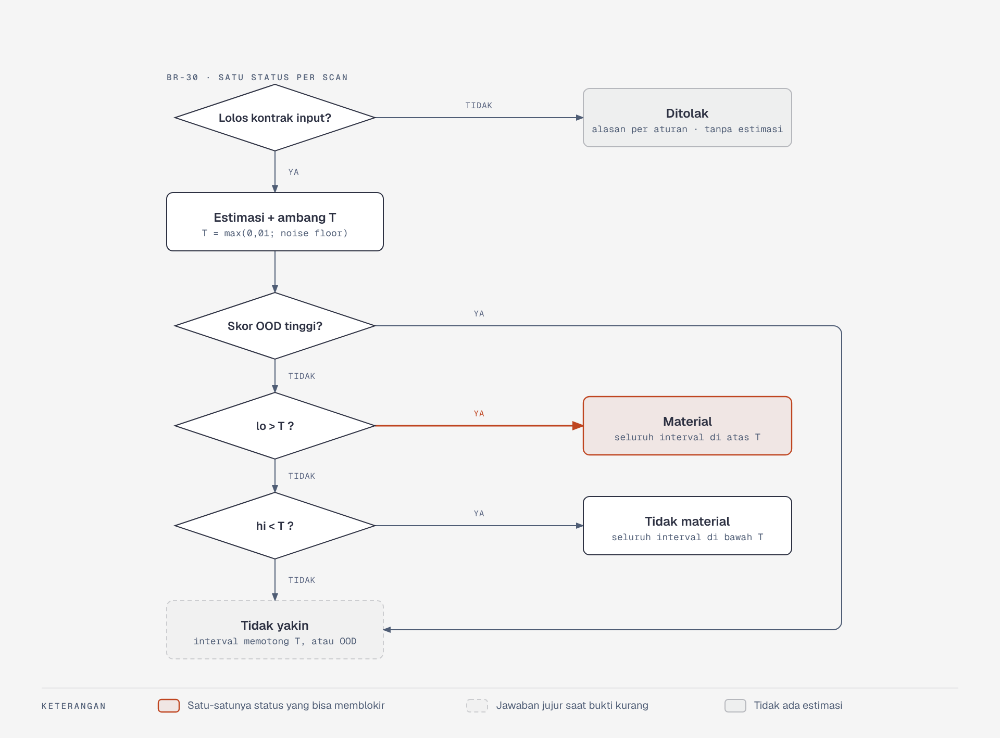

# Aturan Bisnis Ceteris

Dokumen ini adalah satu-satunya sumber untuk aturan yang menentukan **angka dan keputusan** Ceteris: cara ΔAUC dihitung, kapan sebuah scan disebut material, apa yang boleh diklaim, dan apa yang dilakukan gate. Kode, laporan, dan dokumen lain merujuk ID aturan di sini (`BR-xx`) dan tidak menyalin ulang isinya.

- Istilah: [domain/glossary.md](domain/glossary.md) · Fitur yang memakai aturan: [product.md](product.md#4-feature-index) · Komponen yang menjalankannya: [architecture.md](architecture.md)
- Penanda status: **[F]** fakta terverifikasi · **[K]** keputusan desain (bisa berubah lewat proses perubahan) · **[T]** terbuka, belum diputuskan. Aturan tanpa penanda berstatus **[K]**.
- Setiap aturan punya kolom **Verifikasi**: uji otomatis atau pemeriksaan yang membuktikan aturan itu dipatuhi.

## 1. Ukuran dasar

| ID | Aturan | Verifikasi |
| --- | --- | --- |
| BR-01 | **ΔAUC** = AUC(model dilatih pada versi bersih) − AUC(model dilatih pada versi kotor). Kedua model memakai learner acuan yang sama dan dievaluasi pada **test set bersih yang sama**. Multikelas memakai macro one-vs-rest. | Uji unit `train`: dua model, satu test set; hash test set sama |
| BR-02 | **ΔAUC relatif** = ΔAUC / (AUC bersih − 0,5). Dilaporkan berdampingan dengan ΔAUC, tidak menggantikannya. | Uji unit dengan contoh 1 |
| BR-03 | **Learner acuan** adalah LightGBM dengan konfigurasi tetap dari `configs/learner.yaml`, mode deterministik, seed eksplisit. Satu versi spesifikasi berlaku untuk seluruh korpus dan untuk probe saat scan. Spesifikasi mengaktifkan bagging baris (`bagging_fraction` < 1, `bagging_freq` = 1) agar seed berpengaruh; nilai fraksinya dibekukan di G1 ([ADR 0009](decisions/0009-paket-keputusan-g1.md)). | Uji determinisme: run yang sama dua kali menghasilkan ΔAUC identik |
| BR-04 | **Noise floor terukur** (riset) berasal dari selisih AUC dua model versi bersih dengan seed berbeda. **Noise floor estimasi** (scan) berasal dari variasi AUC probe antar-seed pada data kotor, karena pengguna tidak punya versi bersih. | Tabel perbandingan keduanya (eksperimen E3, hipotesis H5) |
| BR-05 | **Ambang kerugian material** `T = max(0,01; noise floor)`. Saat scan, noise floor yang dipakai adalah noise floor estimasi. | Uji unit dengan contoh 2 |
| BR-06 | Setiap angka ΔAUC yang ditampilkan disertai **kalimat kondisi**: "dibanding model yang dilatih pada versi bersih dan dievaluasi pada data bersih". | Contract test: field `condition` wajib ada di `ScanReport` |
| BR-07 | Satu metrik untuk riset dan produk: ΔAUC. ΔF1 tidak dipakai. | Pencarian kode: tidak ada field `delta_f1` |

**[T]** Statistik pasti untuk noise floor (rentang, simpangan baku, atau persentil selisih antar-seed) dan jumlah seed probe belum ditetapkan; diputuskan di pilot E0 dan dibekukan di G2. **[K]** Bila H5 gagal menurut kriteria rencana analisis G2, `T` tetap 0,01 dan noise floor estimasi hanya informatif; BR-05 diubah lewat revisi dokumen ini pada saat itu ([ADR 0006](decisions/0006-kerangka-pengujian-rq2b-dan-h5.md)).

## 2. Kontrak input scan

Scan tidak boleh diam-diam menebak bentuk data. Setiap pelanggaran berakhir di **penolakan dengan alasan** atau **peringatan** yang tercatat di `ScanReport.input_warnings`. Angka batas adalah usulan awal **[K]** dan dikalibrasi di prototipe.

| ID | Aturan | Jika dilanggar |
| --- | --- | --- |
| BR-10 | Format CSV atau Parquet; ≤ 1.000.000 baris dan ≤ 500 kolom. | Ditolak |
| BR-11 | Target satu kolom kategorikal, 2–20 kelas, tiap kelas ≥ 20 baris. | Ditolak |
| BR-12 | Probe dan estimator label noise memakai sampel ≤ 100.000 baris dengan seed tetap; ukuran sampel dicatat. | Dicatat di laporan |
| BR-13 | Kolom non-float (integer, string, kategorikal) dengan rasio nilai unik ≥ 0,95 terhadap jumlah baris dianggap kolom ID dan dikeluarkan sebelum probe. Kolom float tidak diperiksa. | Peringatan |
| BR-14 | Kolom datetime diubah menjadi fitur numerik sederhana atau dikeluarkan; kolom teks bebas dikeluarkan. | Peringatan |
| BR-15 | Fitur yang sendirian memprediksi target dengan AUC macro one-vs-rest ≥ 0,99 (pohon keputusan satu fitur, validasi silang 5 lipatan berstrata pada sampel BR-12, seed tetap, hanya dari data kotor) ditandai sebagai kebocoran target; status scan menjadi **tidak yakin**. | Peringatan + status |
| BR-16 | Praproses BR-13 sampai BR-15 adalah bagian dari `ceteris.dqprofile`, sehingga korpus riset dan scan pengguna diproses dengan kode yang sama. | Uji konsistensi jalur (E4): profil identik |
| BR-17 | Hanya partisi latih yang dipindai; laporan menyatakan ΔAUC relatif terhadap test set bersih hipotetis. | Teks laporan |

**[K]** Ambang BR-13 dan BR-15 ditetapkan di [ADR 0005](decisions/0005-ambang-kolom-id-dan-kebocoran-target.md) sebagai usulan awal, dikalibrasi pada prototipe Phase 2 dan dibekukan di G1. **[T]** `max_depth` dan `min_samples_leaf` pohon probe ditetapkan lewat kalibrasi pada kebocoran sintetis dan dibekukan di G1. **[T]** Ambang tetap atau adaptif terhadap label noise: [ADR 0007](decisions/0007-opsi-ambang-kebocoran-adaptif.md). **[T]** Korpus riset hanya berisi 2.000–50.000 baris dengan split acak, sedangkan BR-10 menerima sampai 1 juta baris; data di luar rentang korpus diperkirakan sering berstatus tidak yakin (lihat BR-33).

## 3. Estimasi dan interval

| ID | Aturan | Verifikasi |
| --- | --- | --- |
| BR-20 | **Quality profile** dihitung **hanya dari data kotor**. Tidak ada jalur kode yang memberi `dqprofile` akses ke versi bersih atau ke level korupsi asli. | Uji isolasi profil: tanda tangan fungsi hanya menerima satu dataset |
| BR-21 | Estimasi ΔAUC berasal dari meta-model yang dimuat sebagai artefak berversi. Tidak ada pelatihan ulang meta-model per pengguna. | Scan berjalan tanpa akses tulis ke model registry |
| BR-22 | **Interval 90%** memakai conformal prediction dengan kalibrasi berbasis grup: skor kalibrasi berasal dari dataset yang tidak dipakai melatih meta-model. | E3: coverage per dataset |
| BR-23 | Profil dan artefak model harus memiliki `profile_schema_version` yang sama. Jika berbeda, scan gagal dengan galat eksplisit, bukan estimasi. | Uji unit versi tidak cocok |
| BR-24 | **Skor OOD** = jarak kNN profil ke profil korpus pelatihan meta-model. Skor OOD bukan input meta-model. | Uji unit; daftar fitur meta-model |

**[T]** Kuantil conformal dihitung atas seluruh run kalibrasi (seperti contoh 3) atau dibobot per dataset; diputuskan di rencana analisis G2. **[T]** Besar pelebaran interval saat OOD tinggi dan nilai ambang "OOD tinggi". **[T]** Apakah batas bawah interval dipotong di nol (ΔAUC bisa negatif, misalnya saat missingness informatif).

## 4. Status hasil scan

*Setiap scan berakhir di tepat satu status. Sumber diagram: [diagrams/src/alur-status.html](diagrams/src/alur-status.html).*

| ID | Aturan | Verifikasi |
| --- | --- | --- |
| BR-30 | Setiap scan yang lolos kontrak input menghasilkan tepat satu status: `material`, `tidak_material`, atau `tidak_yakin`. | Uji properti: status selalu satu dari tiga |
| BR-31 | `material` jika dan hanya jika batas bawah interval `lo > T`. | Contoh 2 |
| BR-32 | `tidak_material` jika dan hanya jika batas atas interval `hi < T`. | Contoh 2 |
| BR-33 | `tidak_yakin` jika interval memotong `T` (termasuk `lo = T` atau `hi = T`), jika skor OOD tinggi, atau jika BR-15 terpicu. OOD diperiksa lebih dulu dan mengalahkan BR-31 dan BR-32. | Contoh 2 |
| BR-34 | Interval yang memotong ambang **tidak pernah dibulatkan** ke material atau tidak material. | Uji properti pada interval acak |
| BR-35 | Sebelum gerbang G3, setiap status dan angka mode learned membawa `model.experimental = true`. | Contract test pada artefak pra-G3 |

## 5. Potensi pemulihan dan prioritas

| ID | Aturan | Verifikasi |
| --- | --- | --- |
| BR-40 | **Potensi pemulihan** sebuah temuan = estimasi ΔAUC saat ini − estimasi ΔAUC setelah fitur profil temuan itu dinormalkan ke nilai "tanpa temuan". | Contoh 5 |
| BR-41 | Potensi pemulihan selalu berlabel **"potensi pemulihan ideal"**. Kalimat "naik X jika diperbaiki" dilarang, karena ini kontrafaktual model, bukan efek cleaning nyata. | Pemeriksaan teks laporan |
| BR-42 | Potensi pemulihan antar-temuan **tidak dijumlahkan** dan tidak dibandingkan dengan ΔAUC total sebagai persentase. | Tidak ada field total di `ScanReport` |
| BR-43 | Urutan temuan di laporan memakai potensi pemulihan, bukan volume (`rows_affected_pct`). | E2 (hipotesis H2b) |
| BR-44 | Setiap hasil simulator what-if melewati cek OOD dan berlabel "simulasi". Simulator berada di luar klaim yang dibuktikan skripsi. | Field `ood_score` wajib di respons simulasi |

**[T]** Tabel effort per `issue_type` untuk urutan potensi/effort (fitur F-L08) belum ada. **[K]** Nilai "tanpa temuan" bersifat struktural dan tidak bergantung data (misalnya fraksi missing, duplikat, dan label noise estimasi = 0); fitur tanpa nilai ideal struktural tidak ikut dinormalkan, dan daftar akhirnya dibekukan di G1 ([ADR 0006](decisions/0006-kerangka-pengujian-rq2b-dan-h5.md)).

## 6. Gate

| ID | Aturan | Verifikasi |
| --- | --- | --- |
| BR-50 | Gate memakai aturan status bagian 4 dengan ambang `T_gate = max(T, ambang kebijakan)`. Ambang kebijakan di bawah `T` ditolak saat disimpan. | Contoh 5; uji API kebijakan |
| BR-51 | Pemetaan status ke keputusan: `tidak_material` → **allow**; `tidak_yakin` → **warn**; `material` → **warn** sebelum G3 dan **block** sesudah G3. | Uji tabel keputusan |
| BR-52 | Setiap keputusan gate menyertakan alasan dan tautan laporan. | Contract test `GET /gate/{id}` |
| BR-53 | Gate tidak pernah mengubah data. Quarantine dan saran fix hanya dijalankan atas persetujuan; auto-apply hanya opt-in dan tercatat di audit log. | Uji integrasi: tidak ada operasi tulis ke sumber |
| BR-54 | Perubahan kebijakan gate tercatat di audit log dengan aktor, waktu, dan nilai sebelum-sesudah. | Uji integrasi |

**[T]** Keputusan gate untuk scan yang ditolak kontrak input. **[T]** Perilaku saat layanan gate tidak tersedia (`fail_mode`: warn atau block).

## 7. Versi, histori, dan klaim

| ID | Aturan | Verifikasi |
| --- | --- | --- |
| BR-60 | Setiap `ScanReport` menyimpan `schema_version`, `model.version`, dan `model.profile_schema_version`. Perubahan yang merusak kompatibilitas hanya di versi mayor. | Contract test |
| BR-61 | Scan lama tidak dihitung ulang otomatis saat meta-model naik versi; laporan lama tetap menunjuk versi lamanya. | Uji integrasi |
| BR-62 | Perbandingan antar-scan hanya dibuat pada versi model yang sama. Jika berbeda, profil lama yang tersimpan diestimasi ulang dengan model baru dan perbedaan versi disebutkan. | Uji integrasi |
| BR-63 | Artefak model baru hanya boleh dirilis bila tidak lebih buruk dari laporan akurasi artefak sebelumnya pada set uji regresi. | Gate CI rilis artefak |
| BR-64 | Produk hanya menampilkan klaim yang tercatat di register klaim beserta buktinya. Klaim akurasi dan interval baru boleh tampil setelah G3; akurasi pada data nyata setelah G4. | Tinjauan rilis terhadap register klaim |
| BR-65 | Klaim "interval 90%" berlaku untuk data di dalam distribusi korpus; karena itu flag OOD wajib tampil bersama interval. | Pemeriksaan laporan |

## 8. Data dan privasi

| ID | Aturan | Verifikasi |
| --- | --- | --- |
| BR-70 | **Source-faithful advisory:** Ceteris menandai, mengukur, dan mengarantina. Ceteris tidak mengimputasi dan tidak memperbaiki data secara diam-diam. | Tidak ada jalur kode yang menulis ke data sumber |
| BR-71 | Default eksekusi adalah lokal atau self-host: data mentah tidak meninggalkan lingkungan pengguna. | Scan berjalan tanpa akses jaringan keluar |
| BR-72 | Pada mode hosted, data mentah dihapus paling lambat 24 jam setelah scan selesai. | Uji retensi otomatis |
| BR-73 | Profil hanya dikirim keluar bila diaktifkan pengguna; kolom yang terdeteksi sebagai PII tidak pernah ikut. | Uji unit ekspor profil |

**[F]** cleanlab, pustaka estimasi label noise, berlisensi Apache-2.0 sejak versi 2.8.0 (08/01/2026); versi sampai 2.7.1 berlisensi AGPL-3.0 (dicek 12/11/2026 di PyPI dan GitHub; catatan 04/11/2026 sebelumnya hanya menyebut AGPL-3.0). **[K]** F-S05 memakai cleanlab `>=2.8.0,<3` dengan probabilitas out-of-fold 5 lipatan dari learner acuan ([ADR 0009](decisions/0009-paket-keputusan-g1.md)).

## 9. Aturan eksperimen

Aturan ini menjaga agar angka riset bisa dipercaya dan bisa diulang.

| ID | Aturan | Verifikasi |
| --- | --- | --- |
| BR-80 | Korupsi hanya diterapkan pada partisi latih; partisi uji tidak pernah diubah. | Hash partisi uji sebelum dan sesudah |
| BR-81 | Evaluasi memakai leave-one-dataset-out bersarang: dataset uji tidak dipakai untuk melatih, men-tuning, atau mengkalibrasi. | Uji pembagian fold: irisan dataset kosong |
| BR-82 | Setiap run mencatat level nominal dan `affected_row_frac` (proporsi baris latih yang terdampak). Perbandingan antar-jenis korupsi memakai `affected_row_frac`. | Contoh 4; uji properti corruption engine |
| BR-83 | Korupsi campuran diterapkan dengan urutan tetap: duplikat → label → outlier → missing. | Uji unit urutan |
| BR-84 | Seed setiap run diturunkan dari (`dataset_id`, `config_id`, indeks seed). | Uji determinisme |
| BR-85 | Unit analisis statistik adalah dataset, bukan run. Metrik dihitung per dataset lalu diringkas. | Notebook NB05 |
| BR-86 | Rencana analisis dibekukan di G2. Analisis yang ditambahkan sesudahnya berlabel eksploratif. | Dokumen bertanggal di repository |

## 10. Contoh perhitungan

Semua angka di bawah adalah ilustrasi untuk memeriksa aturan, bukan hasil eksperimen.

### Contoh 1 — ΔAUC dan ΔAUC relatif (BR-01, BR-02)

AUC model versi bersih 0,85; AUC model versi kotor 0,72; keduanya pada test set bersih yang sama.

- ΔAUC = 0,85 − 0,72 = **0,13**
- Headroom = 0,85 − 0,50 = 0,35
- ΔAUC relatif = 0,13 / 0,35 = **0,371** (37,1% headroom hilang)

Pembanding: dataset mudah dengan AUC bersih 0,98 dan AUC kotor 0,95 punya ΔAUC 0,03 tetapi ΔAUC relatif 0,03 / 0,48 = 0,0625. Karena itu keduanya dilaporkan.

### Contoh 2 — Ambang dan status (BR-05, BR-31 sampai BR-33)

| Kasus | Estimasi | Interval 90% `[lo; hi]` | Noise floor | `T = max(0,01; nf)` | OOD | Status | Alasan |
| --- | --- | --- | --- | --- | --- | --- | --- |
| A | 0,031 | [0,012; 0,050] | 0,004 | 0,010 | rendah | **material** | `lo` 0,012 > 0,010 |
| B | 0,031 | [0,006; 0,056] | 0,004 | 0,010 | rendah | **tidak yakin** | interval memotong 0,010 |
| C | 0,031 | [0,012; 0,050] | 0,015 | 0,015 | rendah | **tidak yakin** | `lo` 0,012 < 0,015 < `hi` |
| D | 0,004 | [0,000; 0,008] | 0,004 | 0,010 | rendah | **tidak material** | `hi` 0,008 < 0,010 |
| E | 0,031 | [0,012; 0,050] | 0,004 | 0,010 | tinggi | **tidak yakin** | OOD mengalahkan BR-31 |

Kasus A dan C memakai estimasi dan interval yang sama; yang berubah hanya noise floor. Ini alasan noise floor estimasi harus divalidasi (H5).

### Contoh 3 — Interval conformal (BR-22)

Misalkan ada 19 run kalibrasi dengan skor nonconformity `|ΔAUC aktual − prediksi|`, diurutkan naik:

`0,001 0,002 0,002 0,003 0,004 0,004 0,005 0,006 0,007 0,008 0,009 0,010 0,011 0,012 0,014 0,015 0,017 0,019 0,027`

- Peringkat kuantil = ⌈(n + 1) × 0,90⌉ = ⌈20 × 0,90⌉ = **18**
- Skor ke-18 = **0,019**
- Prediksi untuk dataset baru 0,031 → interval = 0,031 ± 0,019 = **[0,012; 0,050]**

Skor terbesar (0,027) tidak dipakai; itulah yang membuat interval bercakupan 90%, bukan 100%. Dengan 9 run kalibrasi, peringkatnya ⌈10 × 0,90⌉ = 9, yaitu skor terbesar: makin sedikit data kalibrasi, makin lebar intervalnya.

### Contoh 4 — Proporsi baris terdampak (BR-82)

Dataset 10.000 baris, split 80/20 → 8.000 baris latih. Missing MCAR 10% disuntikkan ke 3 kolom secara independen.

- Peluang satu baris tidak terdampak = 0,9³ = 0,729
- `affected_row_frac` yang diharapkan = 1 − 0,729 = **0,271** → sekitar 8.000 × 0,271 = **2.168 baris**
- Label noise 10% pada data yang sama mengubah 8.000 × 0,10 = **800 baris** (`affected_row_frac` = 0,10)

Level nominal keduanya "10%", tetapi baris terdampaknya 27,1% berbanding 10%. Membandingkan dampak keduanya pada level nominal tidak setara; BR-82 mewajibkan perbandingan pada `affected_row_frac` yang sama.

### Contoh 5 — Potensi pemulihan dan gate (BR-40 sampai BR-43, BR-50, BR-51)

Scan menghasilkan estimasi 0,031, interval [0,012; 0,050], `T` = 0,010, OOD rendah (kasus A).

| Temuan | `rows_affected_pct` | Estimasi setelah fitur dinormalkan | Potensi pemulihan ideal |
| --- | --- | --- | --- |
| Label noise | 7% | 0,009 | 0,031 − 0,009 = **0,022** |
| Missing di kolom penting | 18% | 0,025 | 0,031 − 0,025 = **0,006** |

- Urutan menurut volume menaruh missing di atas (18% > 7%); urutan menurut potensi pemulihan menaruh label noise di atas (0,022 > 0,006). Laporan memakai urutan kedua (BR-43).
- 0,022 + 0,006 = 0,028 ≠ 0,031. Selisihnya bukan galat: potensi pemulihan tidak aditif dan tidak dijumlahkan (BR-42).

Keputusan gate untuk scan yang sama:

| Ambang kebijakan | `T_gate` | Status gate | Sebelum G3 | Sesudah G3 |
| --- | --- | --- | --- | --- |
| tidak diatur | 0,010 | material | warn | **block** |
| 0,020 | 0,020 | tidak yakin (0,012 < 0,020 < 0,050) | warn | warn |
| 0,005 | — | kebijakan ditolak saat disimpan (0,005 < `T`) | — | — |

## 11. Daftar hal terbuka

| # | Hal terbuka | Aturan terdampak | Diputuskan paling lambat |
| --- | --- | --- | --- |
| 1 | Statistik noise floor dan jumlah seed probe | BR-04, BR-05 | G2 |
| 2 | Validitas noise floor estimasi (H5) | BR-05, BR-31 sampai BR-33 | G3 |
| 3 | Ambang "OOD tinggi" dan besar pelebaran interval | BR-24, BR-33 | G3 |
| 4 | Kuantil conformal: seluruh run atau dibobot per dataset | BR-22 | G2 |
| 5 | Interval dipotong di nol atau tidak | BR-22 | G2 |
| 6 | Hiperparameter probe kebocoran target dan pilihan ambang tetap atau adaptif | BR-15 | G1 |
| 7 | Batas ukuran input vs rentang korpus | BR-10 | Sebelum R1 |
| 8 | Keputusan gate untuk scan yang ditolak; `fail_mode` | BR-51 | Sebelum R2 |
| 9 | Tabel effort per `issue_type` | BR-43 | Sebelum R2 |
| 10 | **Ditutup [K]**: estimator label noise memakai cleanlab `>=2.8.0,<3` ([ADR 0009](decisions/0009-paket-keputusan-g1.md)) | — (fitur F-S05) | — |
| 11 | Jenis keacakan **ditutup [K]**: bagging baris ([ADR 0009](decisions/0009-paket-keputusan-g1.md)). Masih terbuka: nilai `bagging_fraction` | BR-03, BR-04 | G1 |
